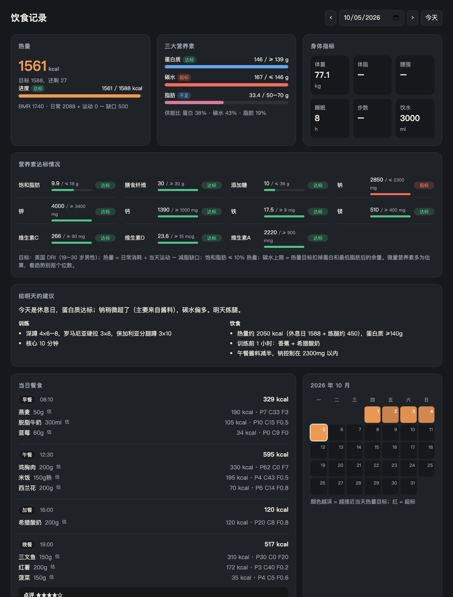

# diet-log

和 [Claude Code](https://claude.com/claude-code) 配合使用的饮食记录系统。**你只负责说吃了什么、拍照**，其余交给 Claude：

- 把口语（「中午吃了碗牛肉面加个卤蛋」）拆成条目，估算 **15 项营养素**（热量、三大营养素、饱和脂肪、纤维、添加糖、钠、钾、钙、铁、镁、维生素 A/C/D）
- 看营养成分表照片时以标签数据为准；读体脂秤截图，自动录入身体指标
- 照片自动命名归档：`photos/2026-10/2026-10-05_1230_午餐_牛肉面.jpg`
- 每餐给出点评和可执行的改进建议（「面饼只吃一半」「调料减到 5g」）
- 根据最近几天练过的部位和当天的营养缺口，写好第二天的训练和饮食计划
- 按天计算热量目标：BMR × 日常系数 + 当天运动 − 减脂缺口
- 本地看板：显示达标/不足/超标、14 天热量与营养素趋势、体重曲线、月历、照片墙



## 安装

```bash
git clone https://github.com/van18615302908/diet-log.git ~/Desktop/diet-log
cd ~/Desktop/diet-log
cp profile.example.json profile.json      # 填身高、年龄、目标，about 里写一段自我介绍

# 装成 Claude Code skill，在任何目录聊吃的都能触发
mkdir -p ~/.claude/skills
ln -s "$PWD/skill/diet-log" ~/.claude/skills/diet-log
# 如果不放在 ~/Desktop/diet-log，再设置：export DIET_LOG_DIR=/your/path
```

依赖：Python 3.10+（只用标准库）。照片转格式用的是 macOS 自带的 `sips`。

## 使用

直接和 Claude 说话就行：

> 中午吃了三个 taco，牛肉 435g（20% 肥，倒了油），洋葱 100g，番茄 200g，彩椒 200g
> 今天打了 3 小时排球
> [拖进一张体脂秤截图]
> 这周蛋白质够吗？明天练什么？

然后双击 `index.html` 打开看板，用 ←/→ 键切换日期。

Claude 的完整工作规则在 [`CLAUDE.md`](CLAUDE.md)。CLI 也可以自己用：

```bash
python3 diet.py meal --type 午餐 --items '[{"name":"牛肉面","amount":"1碗","kcal":550,"protein":28,"carb":75,"fat":14}]'
python3 diet.py exercise --name 力量训练 --minutes 60 --met 5 --parts 背,核心
python3 diet.py body --weight 70.2 --water 2500
python3 diet.py photo IMG_1234.HEIC --kind meal --meal 午餐 --desc 牛肉面
python3 diet.py review --type 午餐 --score 3 --good "..." --fix "..."
python3 diet.py advice --summary "..." --training "..." --diet "..."
python3 diet.py show            # 今天的汇总和各营养素状态
python3 diet.py stats --days 7
python3 diet.py build           # 重新生成看板数据
```

## 目录结构

```
CLAUDE.md               Claude 的工作规则
skill/diet-log/         Claude Code skill
diet.py                 CLI
index.html              看板（读取 web/data.js）
profile.example.json    个人资料模板
data/days/*.json        每天一个文件        ┐
photos/YYYY-MM/         归档后的照片        │ 个人数据，已写进 .gitignore，
profile.json            你的个人资料        │ 不会被提交
web/data.js             生成的看板数据      ┘
```

## 说明

营养数值大多是 Claude 估算的，适合看趋势，不适合精确计量。营养素目标默认用美国 DRI（19–30 岁男性），可以在 `profile.json` 的 `nutrient_targets` 里改。本项目不是医疗建议。
